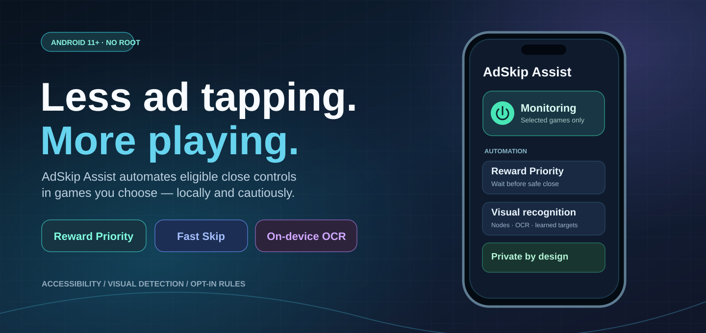
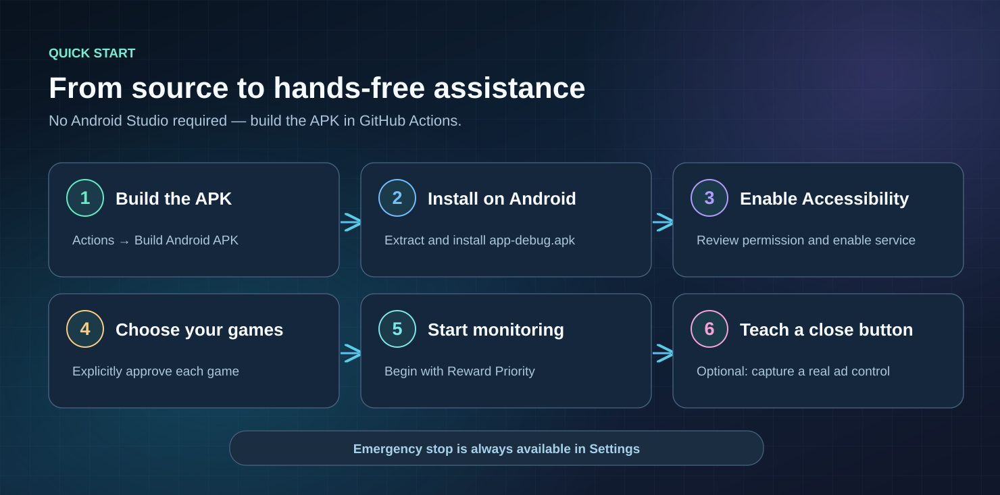
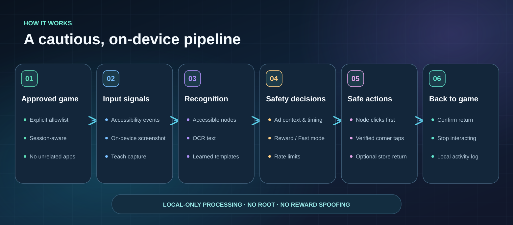
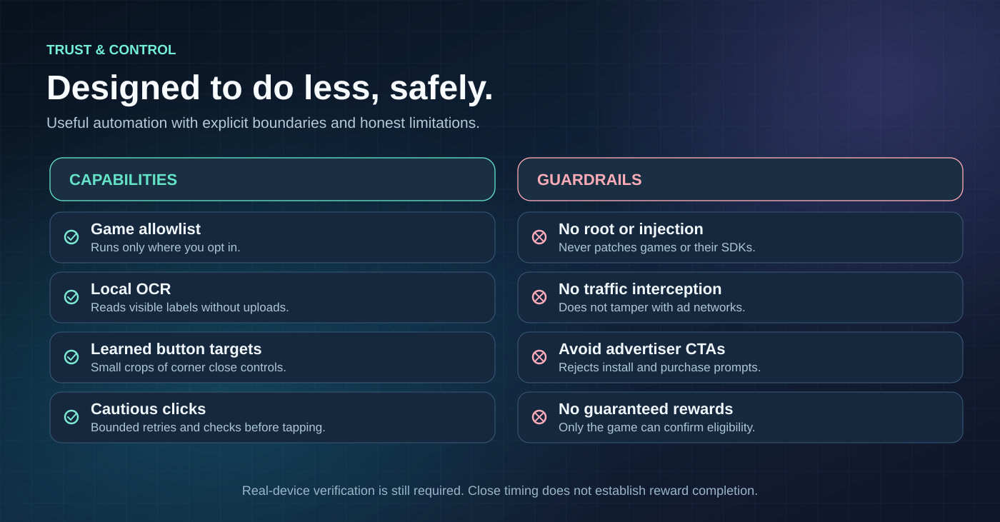

<p align="center">
  
</p>

<p align="center">
  <a href="https://github.com/shinynaps/adskip/actions/workflows/android-apk.yml"></a>
  
  
  
  
</p>

<p align="center">
  <strong>A quiet, privacy-first Android companion for mobile-game advertisements.</strong><br>
  Recognize supported ad close controls, automate safe dismissals, and get back to playing.
</p>

<h2 align="center">📲 Download AdSkip Assist for Android</h2>

<p align="center">
  <a href="https://github.com/shinynaps/adskip/releases/download/preview/AdSkip-Assist-preview.apk"></a>
</p>

<p align="center"><strong><a href="https://github.com/shinynaps/adskip/releases/download/preview/AdSkip-Assist-preview.apk">⬇️ DOWNLOAD THE APK INSTALLER</a></strong> &nbsp;·&nbsp; <a href="docs/INSTALL.md">Simple installation guide</a> &nbsp;·&nbsp; <a href="https://github.com/shinynaps/adskip/releases/tag/preview">Preview release details</a></p>

> [!CAUTION]
> **Google Play Protect may block installation of this APK.** AdSkip Assist uses Android's sensitive AccessibilityService API, so Android's enhanced fraud protection can prevent browser/file-manager installations, particularly in the Philippines. **Do not disable Play Protect to proceed.** This is different from Android's separate “Restricted setting” prompt. See [why Play Protect blocks this APK and the developer-testing options](docs/PLAY_PROTECT.md).

> [!NOTE]
> **Android 11+ · Preview / testing build · No Android Studio required.** The link downloads the <code>.apk</code> directly (no Actions ZIP and no GitHub login required for this public release). You may need to approve installing an APK from your browser or Files app. Builds are not yet real-game verified. Because preview builds are debug-signed in CI, later builds may require uninstalling the previous version first, which erases local settings and taught buttons.


> [!IMPORTANT]
> **AdSkip Assist cannot instantly complete rewarded ads or guarantee rewards.** Game and ad-SDK completion rules still apply. Reward Priority uses timing and visible hints, **not** access to SDK reward callbacks. No reward spoofing, APK modification, or ad-traffic interception is performed. **Physical-device compatibility is still being verified.**

## Explore

[Quick start](#quick-start) · [Features](#features) · [How it works](#how-it-works) · [Safety and limitations](#safety-and-limitations) · [Build](#build-locally) · [Testing](#testing) · [Troubleshooting](#troubleshooting)

## Quick start



**If Play Protect allows installation, setup has three steps.** Some Android devices will block the APK before step 1 completes; [read the explanation first](docs/PLAY_PROTECT.md).

1. **[Download the APK](https://github.com/shinynaps/adskip/releases/download/preview/AdSkip-Assist-preview.apk)** on your Android phone. Open `AdSkip-Assist-preview.apk` and tap **Install** when prompted. (This is a test build, not a Play Store app.)
2. Open AdSkip Assist, go to **Settings**, read the privacy disclosure, grant consent, and enable **AdSkip Assist — selected games only** through Android Accessibility settings.
3. In **Games**, enable the games you approve. Back on **Home**, tap **Start monitoring** and begin with **Reward Priority**.

**Optional:** Enable OCR or learned buttons in Settings. The **Teach** action captures a button from a real ad, and stores only a small corner crop. Use **Settings → Emergency stop** whenever needed.

> [!NOTE]
> Android 13+ can show **Restricted setting** for sideloaded accessibility apps. Depending on your phone, Android may offer **Settings → Apps → AdSkip Assist → ⋮ → Allow restricted settings**. Review permissions carefully; don't disable system security protections. If you have already installed an older debug APK signed with another key, you may have to uninstall it before installing this one, losing local configuration.

**Want to build from source?** Use [GitHub Actions](https://github.com/shinynaps/adskip/actions/workflows/android-apk.yml) or the [local build instructions](#build-locally). **You do not need to build anything just to install the preview APK.**

## Features

| Feature | How it behaves |
| --- | --- |
| **Selected games only** | Per-game allowlist, mode override, and minimum wait settings. |
| **Reward Priority** | Defers close actions based on visible completion hints or a configurable minimum wait. **Rewards are not assured.** |
| **Fast Skip** | Uses controls earlier when available; may forfeit rewarded-ad credit. |
| **Accessibility detection** | Inspects accessible window events, actionable nodes, bounds, and ad context; prefers node clicks. |
| **On-device OCR** | Optional ML Kit analysis of supported screenshots on Android 11+. Some graphics cannot be read. |
| **Teach a button** | Saves a small local crop of a user-selected corner control for future visual matching. |
| **Cautious gestures** | High-confidence, corner-only fallback with rate limits and repeat checks. |
| **Multi-stage handling** | Tracks ad stages and retries with timeouts; optional bounded Play Store recovery. |
| **Local activity history** | Stores action summaries and settings on device, without sending screenshots to a server. |

Visuals in this README are **conceptual illustrations**, not verified screenshots, metrics, or evidence that an ad/reward was successfully handled.

## How it works



The detection pipeline is intentionally conservative. **Accessible UI nodes** are preferred; optional **screenshot OCR** and **user-taught button templates** are fallback signals. The action layer checks the approved game, recent ad context, corner location, time gates, and retry limits before clicking.

A screenshot can be blocked by secure windows. Graphically rendered game content may not expose usable accessibility nodes. Some ad types therefore cannot be automated reliably.

## Safety and limitations



- **No root, APK patching, SDK injection, reward callback forgery, network interception, or account credentials.**
- Screenshot analysis and saved learned-button crops stay local. Screenshots used in teaching are discarded after selection.
- Never blindly treat an **Install**, **Buy**, or advertiser CTA as a close button.
- Reward Priority's delay is a **heuristic**, not proof of the game's reward verification.
- Visual matches can fail across screen orientations, sizes, animations, overlays, or ad-network changes.
- This is designed for **personal sideloading**; Google Play AccessibilityService distribution rules require separate assessment.

See [technical feasibility](docs/TECHNICAL_FEASIBILITY.md) and [device verification checklist](docs/MANUAL_DEVICE_TEST_CHECKLIST.md).

## Build locally

Requirements: **JDK 17**, Android SDK platform **35**, build tools **35.0.0**, and **Gradle 8.11.1**. Android Studio is optional.

```bash
sdkmanager "platforms;android-35" "build-tools;35.0.0"
gradle --no-daemon :app:testDebugUnitTest :app:assembleDebug
```

Output: `app/build/outputs/apk/debug/app-debug.apk`.

The repository includes Gradle wrapper properties but not the binary wrapper JAR. GitHub Actions installs Gradle, uploads the build artifact, then publishes the **latest successful main-branch debug APK** to the [Preview Release](https://github.com/shinynaps/adskip/releases/tag/preview). A passing CI build does **not** verify device accessibility behavior or reward eligibility.

## Testing

- JVM unit tests cover core state transitions and recognition rules.
- The [APK workflow](https://github.com/shinynaps/adskip/actions/workflows/android-apk.yml) builds and tests the project.
- Manual testing is required for screenshots, OCR, overlays, gestures, foreground-package changes, Android version differences, Play Store recovery, and real game/ad-network behavior.
- Reward outcomes must be checked **inside the game**, never inferred from an automatic close.

Follow [manual device test checklist](docs/MANUAL_DEVICE_TEST_CHECKLIST.md). Report incorrect clicks with reproducible steps, but **do not upload personal screen data**.

## Troubleshooting

| Problem | Try this |
| --- | --- |
| Service shows inactive | Review consent, Accessibility settings, game allowlist, and monitoring switch. |
| Game isn't listed | Disable the *Game-classified apps only* filter and search by package. |
| Ad won't close | The control may be inaccessible or fail context checks. Try OCR or teach a real corner close button. |
| Wrong button was pressed | Use **Emergency stop** immediately, disable that game, and review the learned target. |
| Ad closed but reward was lost | Minimum watch timing does not guarantee credit; increase the per-game wait or use Fast Skip only if rewards are optional. |
| Screenshot/OCR fails | Android secure-window restrictions, API support, and game rendering can prevent capture or recognition. |
| Play Protect says “App blocked to protect your device” | Android's enhanced fraud protection can block browser-installed APKs that declare AccessibilityService. [Read the official explanation and our safety guidance](docs/PLAY_PROTECT.md). **Do not disable Play Protect.** |
| Installer download unavailable | Check the [Preview Release](https://github.com/shinynaps/adskip/releases/tag/preview). It is published after a successful main-branch build; if missing, inspect [Actions](https://github.com/shinynaps/adskip/actions/workflows/android-apk.yml). |

## Project notes

The native interface is built with **Jetpack Compose / Material 3**. Design guidance is informed by [Impeccable](https://github.com/pbakaus/impeccable) and [Taste Skill](https://github.com/leonxlnx/taste-skill), with app-specific constraints documented in [DESIGN.md](DESIGN.md) and [PRODUCT.md](PRODUCT.md). These skills are not runtime dependencies.

| Path | Purpose |
| --- | --- |
| `app/src/main/java/com/adskip/assist/automation/` | Accessibility service, ad detection, state machine, visual matching. |
| `app/src/main/java/com/adskip/assist/data/` | App-private settings, event logs, statistics. |
| `app/src/main/java/com/adskip/assist/MainActivity.kt` | Native Compose interface. |
| `app/src/test/` | JVM logic tests. |
| `.github/workflows/android-apk.yml` | Test, build, and publish the APK to GitHub Releases and Actions artifacts. |
| `docs/assets/readme/` | Lightweight, editable vector README illustrations. |

---

<p align="center"><sub>AdSkip Assist · Selected games. Cautious automation. Your device stays in control.</sub></p>
